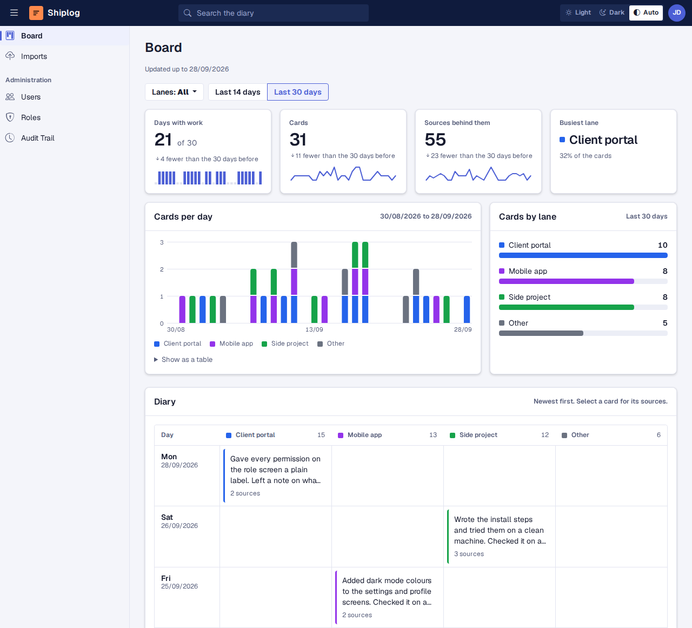

# Shiplog

A self-hosted work diary that writes itself from your git commits and Claude Code sessions.



A Claude Code skill reads what you committed and what you worked through with Claude, writes one
short card per project ("lane") per day, and Shiplog shows them as a board: newest day first, each
card opening to the commits and sessions behind it. You stop losing track of what you did last
week, without keeping a log by hand.

## What it does

- **A board of your days.** Days down, lanes across, a 2 to 4 line card per lane per day, and a
  dash where a lane had no work. Thirty days with work per page.
- **Cards built from records.** Each card lists its sources (commits, Claude Code sessions,
  artifacts, notes), linked where they have an address.
- **Your own lanes.** You name the lanes (a client, a product, "Personal") and the repositories that
  feed each; they arrive with every import.
- **Imports that never delete.** A file adds or replaces the cards for its days and leaves every
  other day alone. A file with any problem is refused whole, with every problem listed.
- **A public demo mode.** One setting turns a copy into a read-only board with invented data.

## How it works

1. You ask Claude Code to "update my board".
2. The `shiplog-update` skill reads your commits and sessions since the last update and writes a
   `shiplog/v1` JSON file.
3. `php artisan shiplog:import`, or the upload screen, checks the file and loads it.
4. The board shows the new cards.

The file format is documented below, so any other tool can write Shiplog files too.

## Install

You need PHP 8.4 with the `pdo_sqlite` extension, Composer and Node.js 22 or later. SQLite is the
default, so there is no database server or Redis to run.

```bash
git clone https://github.com/mohamadsyukri/shiplog.git
cd shiplog
composer setup
```

`composer setup` installs the PHP and JavaScript packages, creates `.env` and the SQLite database
(`database/database.sqlite`), adds the first administrator and builds the front end. The
administrator's password is printed once. To choose it instead, copy `.env.example` to `.env` and
set `ADMIN_EMAIL` and `ADMIN_PASSWORD` before running `composer setup`.

Serve `public/` with your web server, or run `php artisan serve` and open http://localhost:8000.
For MySQL, set `DB_CONNECTION=mysql` and the `DB_*` lines in `.env` first.

## Update your board with Claude Code

1. Copy the skill into Claude Code: `cp -r skill/shiplog-update ~/.claude/skills/`
2. Create your settings from the example:

   ```bash
   mkdir -p ~/.config/shiplog
   cp skill/shiplog-update/config.example.json ~/.config/shiplog/config.json
   ```

   Then edit it: your timezone, the email addresses you commit with, where to write files
   (`storage/app/shiplog` in your copy is git-ignored), how to import them, and your lanes with the
   repository folders that feed each.
3. In any Claude Code session, say **"update my board"**.

The first run goes back to your earliest commit, one file per month. Claude Code deletes session
transcripts after 30 days unless you raise `cleanupPeriodDays` in `~/.claude/settings.json`, so
older days are built from commits alone.

## Import a file yourself

```bash
php artisan shiplog:import storage/app/shiplog/shiplog-2026-10-20_to_2026-10-21.json --dry-run   # check only
php artisan shiplog:import storage/app/shiplog/shiplog-2026-10-20_to_2026-10-21.json             # import
```

Or upload it on **Imports > Upload** (2 MB at most); every import is listed in the history there.
The System Administrator may upload; grant Imports to other roles on **Administration > Roles**.

## Import file format

Shiplog reads one JSON file per update, written by the Claude Code skill or by any collector you
write yourself. This example is the importer's test fixture, so it always matches what the
importer accepts (`shiplog/v1`):

```json
{
    "format": "shiplog/v1",
    "range": { "from": "2026-10-20", "to": "2026-10-21" },
    "lanes": [
        { "key": "client-portal", "name": "Client portal", "color": "#2563eb", "order": 1 },
        { "key": "side-project", "name": "Side project", "color": "#16a34a", "order": 2 },
        { "key": "other", "name": "Other", "color": "#6b7280", "order": 3 }
    ],
    "entries": [
        {
            "date": "2026-10-20",
            "lane": "client-portal",
            "summary": "Fixed the invoice total that counted the delivery fee twice on split orders, with a test for the split case.",
            "sources": [
                { "type": "commit", "ref": "3f9c2ab", "label": "Orders (Checkout): stop charging the delivery fee twice on split orders", "url": null },
                { "type": "session", "ref": "b2e41d07-5c1a-4f0e-9a43-7d2f8e6c1b90", "label": "Trace the double delivery fee", "url": null }
            ]
        },
        {
            "date": "2026-10-21",
            "lane": "side-project",
            "summary": "Sketched the weekly summary screen and wrote down the open questions.",
            "sources": [
                { "type": "artifact", "ref": "weekly-summary-sketch", "label": "Weekly summary sketch", "url": "https://example.com/weekly-summary-sketch" },
                { "type": "note", "ref": "weekly-summary-questions", "label": "Open questions for the weekly summary", "url": null }
            ]
        }
    ]
}
```

- `range` is the days the file covers; every card's `date` falls inside it (`YYYY-MM-DD`).
- `lanes` lists every lane the cards use. A lane is created or updated by its `key`: 1 to 40
  lowercase letters, digits or hyphens. `color` is `#rrggbb`; `order` places it on the board.
- One card per lane per day, with a summary of at most 600 characters and at least one source.
  Importing a card replaces the one stored for that day and lane; an import never deletes cards.
- A source's `type` is `commit`, `session`, `artifact` or `note`; `url` is an http(s) address or
  `null`.
- A file with any problem is refused whole, with one message per problem, and nothing is written.

## Demo mode

`DEMO_MODE=true` turns a copy into a public, read-only board: only the board is served, to anyone,
and there is no sign-in, upload or admin page to write through. Set `SESSION_DRIVER=file` as well,
so visitors leave no rows behind, then fill it with invented data:

```bash
php artisan migrate
php artisan db:seed --class=DemoSeeder
```

`DemoSeeder` writes four lanes and 108 cards from 1 July to 28 September 2026, the same on every
run. It refuses to run without demo mode, so it can never reach a real diary.

## Development

| Do | Command |
|---|---|
| Run the tests | `npm run build` once, then `php artisan test --compact` (SQLite in memory) |
| Format PHP | `vendor/bin/pint` |
| Browser checks | `PLAYWRIGHT_BASE_URL=… PLAYWRIGHT_ADMIN_EMAIL=… PLAYWRIGHT_ADMIN_PASSWORD=… npx playwright test` |

The browser checks run against a real site, and the upload check imports the README example into
its database.

Shiplog started from [laravel-template](https://github.com/mohamadsyukri/laravel-template): Laravel
13, Fortify, spatie/laravel-permission, spatie/laravel-activitylog, Bootstrap 5.3 and Pest.

## License

MIT, see [LICENSE](LICENSE).
